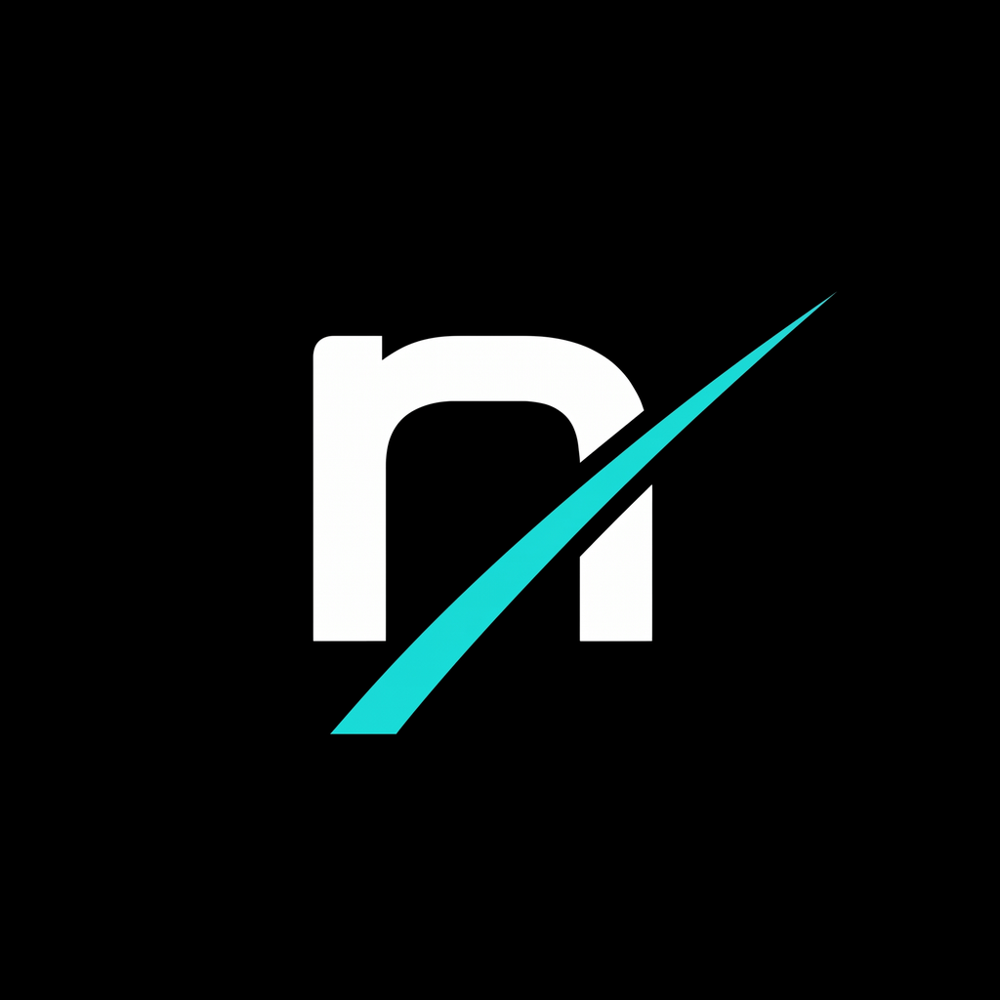

  

  # Nexus

  

    <strong>A clean, local-first study planner, deep focus timer, and daily routine tracker for Android.</strong>
  

  

    
    
    
    
  

  

    <a href="https://github.com/rezagh-dev/Nexus/releases/latest/download/Nexus_v1.0.0.apk"><strong>Download APK</strong></a> ·
    <a href="https://rezagh-dev.github.io/Nexus/"><strong>Website</strong></a> ·
    <a href="mailto:r.ghazizadeh14@gmail.com"><strong>Report Issue</strong></a>
  

---

## About Nexus

Nexus is an all-in-one productivity workspace designed for students and self-learners to plan daily study sessions, stay focused with a reliable lock-screen timer, and analyze academic progress over time. Built with privacy and consistency at its core, the application integrates daily habit tracking—including sleep routines, supplements, and nutrition logs—into a single distraction-free dashboard. All personal schedules, statistics, and session data remain stored 100% locally on your device with zero cloud tracking or mandatory accounts.

---

## Screenshots

| Study Planner | Focus Timer | Analytics | Bio-Routine |
| :---: | :---: | :---: | :---: |
|  |  |  |  |

---

## Core Features & Options

* **Daily Study Planner**: Plan, prioritize, and color-code study blocks by subject. Track completed hours against daily goals, write quick focus notes, and toggle effortlessly between Gregorian and Jalali (Solar) calendar formats.
* **Focus Timer & Stopwatch**: Choose between an interval countdown timer or an open-ended stopwatch. Includes customizable alarm sounds, reliable background operation, and a persistent lock-screen alarm overlay with a `Slide to Stop` slider.
* **Study Analytics**: View clear visual breakdowns of your study habits. Review daily and weekly timelines, time allocations per subject, and cumulative hours studied down to the minute.
* **Bio & Routine Tracker**: Track supporting habits that influence mental clarity. Log sleep hours, maintain supplement or medication checklists, and monitor daily meal timings.
* **Level & XP Progression**: Gain momentum through a lightweight progression system. Earn 100 XP for every completed hour of study to advance across 8 rank tiers (*Bronze, Silver, Gold, Platinum, Diamond, Master, Grandmaster, and Legend*).
* **Customization & Data Control**: Toggle between tailored Dark and Light themes, switch languages between English and Persian, configure daily reminder notifications, and export or import your data anytime using clean local JSON backups.

---

## Tech Stack

* **Framework**: Flutter & Dart
* **State Management**: GetX
* **Database**: Local SQLite & SharedPreferences
* **Native Integration**: Android Kotlin (`AlarmManager`, `WakeLock`, and Lock-Screen Window Flags)

---

## Installation

1. Download the latest release package [**`Nexus_v1.0.0.apk`**](https://github.com/rezagh-dev/Nexus/releases/latest/download/Nexus_v1.0.0.apk) from the [Releases](https://github.com/rezagh-dev/Nexus/releases) page.
2. Tap the downloaded APK on your Android device (Android 8.0 or higher). If prompted, enable **"Allow from this source"** in your browser settings.
3. Open Nexus and start organizing your study schedule immediately—no account setup or internet connection required.

---

## Author & Contact

Designed and developed by **Reza Ghazizadeh**.

* **GitHub**: [@rezagh-dev](https://github.com/rezagh-dev)
* **Email**: [r.ghazizadeh14@gmail.com](mailto:r.ghazizadeh14@gmail.com)
* **Live Showcase**: [rezagh-dev.github.io/Nexus](https://rezagh-dev.github.io/Nexus/)

---

### License

This project is licensed under the MIT License — see the [LICENSE](LICENSE) file for details.
